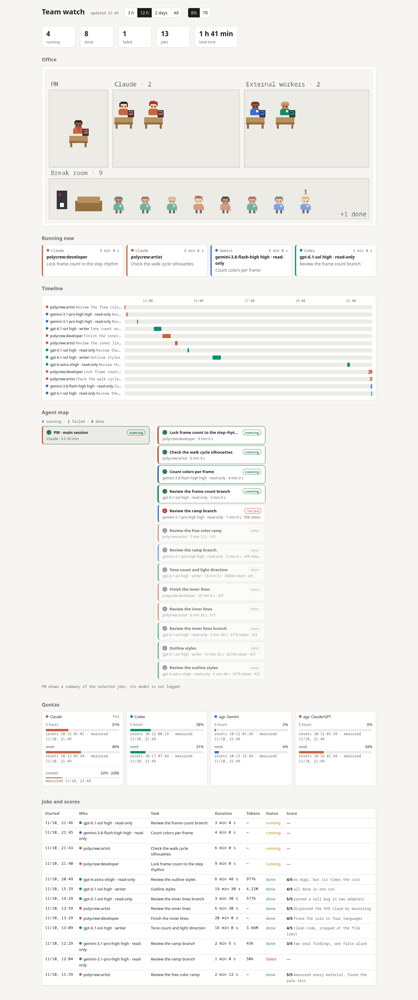

# polycrew

[](https://github.com/MZDemirel/Polycrew/actions/workflows/ci.yml)

**A multi-model crew for Claude Code.** Long projects keep their memory between sessions, and big tasks are split across a small team: Claude roles plus external Codex and Gemini workers, picked by measured quality and cost. You can watch all of them on one live page.

[Türkçe](README.tr.md)



## What it is for

Claude Code is strong in one session, but long projects run into three problems:

1. **It forgets between sessions.** Decisions, open issues and "where we left off" live in chat history that is gone tomorrow.
2. **Agents are expensive and invisible.** Several subagents in parallel drain your usage limit within hours. In the VS Code extension they are collapsed rows, and you cannot tell who is doing what.
3. **One model is not best at everything.** Codex is a careful, cheap reviewer. Claude is the better judge of visual work. Gemini quotas are generous. Nothing tells you which to use where.

polycrew answers each one:

- **Session workflow.** Every project gets a `CLAUDE.md` (rules), a `PLAN.md` (stages with checkboxes), numbered decision notes in `docs/decisions/`, and a `NEXT_SESSION.md` hand-off with a ready start prompt. Opening and closing a session are two commands.
- **A PM-led team.** The main session acts as project manager. It splits a stage into streams and hands items to roles (developer, artist, reviewer, designer, researcher, lead). Developers work in their own git worktree and branch; only the PM merges to `main`.
- **External workers.** Codex and Gemini (through `agy`) run non-interactively with a chosen model and effort, in read-only or writer mode, with full logs. That spreads the work across three quotas.
- **A measured roster that keeps learning.** Which worker gets which job (by role, field and difficulty) comes from real runs with scores, time, tokens and quota use, not from guesses. Every score the PM gives goes into a ledger, and `roster.py suggest` ranks the workers from it. See [`skills/team/roster.md`](skills/team/roster.md) and decisions [`0002`](docs/decisions/0002-agent-deneyi.md) and [`0004`](docs/decisions/0004-dinamik-kadro.md).
- **Live visibility.** Hooks and the worker script write one event log. A local page shows an agent map (who started whom, who is still running), a timeline, quota cards for all three providers, each worker's last report and the PM's scores. At the end of the session the same view becomes a shareable report.

## Commands

Call them as `/polycrew:<name>`, or just `/<name>` when the name is unique. Up to 0.4 the commands and roles had Turkish names; the mapping is in [`docs/decisions/0007-ingilizce-yuzey.md`](docs/decisions/0007-ingilizce-yuzey.md).

| Command | What it does |
|---|---|
| `/project-setup` | Creates `CLAUDE.md`, `PLAN.md`, `NEXT_SESSION.md` and `docs/decisions/` in a project; never overwrites. |
| `/session-start` | Reads the notes, checks git, worktrees and tests, asks for feedback, starts in plan mode. |
| `/session-end` | Ticks checkboxes, writes decisions, updates the hand-off notes and the start prompt, publishes the team report, commits. |
| `/decision` | Writes a short numbered decision note. |
| `/team` | Runs a stage with a team: the PM splits it, assigns workers by difficulty, reviews and merges. |
| `/external-agent` | Runs a task on Codex or Gemini/agy (model, effort, read-only or writer) and logs everything. |
| `/watch` | Opens the live team page and produces the session report. |

### Roles (`agents/`)

| Role | Default model | Writes code? | Job |
|---|---|---|---|
| `developer` | Sonnet, high effort | yes, in its own worktree | Codes one item with tests and commits on its branch. |
| `reviewer` | Sonnet, high effort | no | Reviews a branch against the project's definition of done. |
| `artist` | Opus | no | Judges and measures visual output (colors, contrast, stray pixels). |
| `designer` | Opus | no | Turns options into a step-by-step plan and a decision draft. |
| `researcher` | Haiku | no | Answers questions from code and the web, with sources. |
| `lead` | Sonnet | no | Runs one stream in a truly large parallel stage. |

## Requirements

- [Claude Code](https://docs.claude.com/en/docs/claude-code) (CLI, VS Code extension or desktop app).
- `bash`, `git` and Python 3 (standard library only).
- Optional, for external workers:
  - [Codex CLI](https://github.com/openai/codex), signed in;
  - `agy` (Antigravity CLI) for Gemini.
  - Neither is needed for the session workflow or the Claude team.

## Installation

From GitHub:

```bash
claude plugin marketplace add MZDemirel/polycrew
claude plugin install polycrew@polycrew
```

From a local clone (for development):

```bash
git clone https://github.com/MZDemirel/polycrew.git
claude plugin marketplace add ./polycrew
claude plugin install polycrew@polycrew
```

Then run `/reload-plugins` in an open session, or start a new one.

- **Update:** `claude plugin marketplace update polycrew && claude plugin update polycrew@polycrew`
- **Remove:** `claude plugin uninstall polycrew@polycrew`

## A typical session

```text
/project-setup     # once per project: rules, plan, decisions, hand-off notes
/session-start     # every session: read notes, check git and tests, plan
/team         # for a stage worth a team; /watch opens the live page
/session-end   # notes, decisions, team report, commit
```

`/session-end` writes a start prompt into `NEXT_SESSION.md`. Paste it next time and the new session picks up where the last one stopped.

## Watching the team

```text
/watch
```

The page runs at `http://localhost:8770`. In VS Code, open it with `Ctrl+Shift+P → Simple Browser: Show`. It is in English and Turkish: it follows your browser language, and the EN/TR buttons or `?lang=en` switch it. It refreshes every few seconds and shows:

- **Running now:** role or model, task, elapsed time.
- **Agent map:** a left-to-right tree with the PM at the root and the workers it started (Claude roles, Codex, Gemini) as branches. Running workers are green and pulse, finished ones fade, and a count sits on top. It answers "who is doing what, and who started whom" at a glance.
- **Timeline:** Claude in orange, Codex in green, Gemini in blue. Click a bar to see the worker's last report and its task.
- **Quotas:** one card per provider with its latest measurement: Codex 5-hour and weekly windows, Gemini, Claude through agy, and Claude Code itself. A measurement older than the window's reset time is dimmed and marked as stale.
  - Claude's own usage cannot be read from the CLI. The PM reads it (the desktop app's usage tool, or `/usage`) and records it with `skills/watch/claude-quota.py --five-hour <%> --week <%> ...`; without arguments the script prints the last measurement, and it warns at 80% of the 5-hour window or 70% of the week. It does not update by itself.
- **Jobs and scores:** duration, tokens, status and the PM's 1–5 score with a reason.

Under the hood:

- Hooks (`PreToolUse` on the Agent tool, `SubagentStart`, `SubagentStop`) and `external-agent.sh` append to one log.
- The PM adds scores with `python3 hooks/events.py score <job id> <1-5> "<reason>" --worker <worker> --role <role> --field <field> --difficulty <E|M|H>`. The score shows on the page and is appended to the ledger.
- `skills/watch/watch.py report --lang en --out report.html` renders the same view as a static page. `/session-end` publishes it.
- The screenshots come from an example log: `docs/img/ornek_gunluk.py en|tr <file>`.

## The roster (`roster.py`)

Scores fade with age: one that is 30 days old counts half (`--half-life`), so an old impression drifts back to neutral instead of sticking forever. Claude workers are recorded with their model version (`claude/developer/sonnet-5-5`), so a new model is ranked by its own runs. The session summary also names a worker to **try** on an easy job when it has little data. A second score for the same job replaces the first. When two workers score within 0.10 of each other, the clearly cheaper or faster one goes first. Workers of a tool that is not installed are left out, so without Codex and agy you get a Claude-only roster.

```bash
python3 skills/team/roster.py suggest                 # best worker per role and field
python3 skills/team/roster.py suggest --role developer --field py # narrowed
```

- The ledger is `~/.local/share/polycrew/puanlar.jsonl`. It outlives sessions and projects, and starts from seed data taken from the measured runs.
- The table shows the best worker per role and field with an adjusted score (few samples pull it towards the middle), the sample count, mean time and the date of the last score. Rows with little data are marked.
- Use it before handing out work, and keep scoring: a worker that starts failing (or starts working, as Gemini did once its permissions were listed in the task) moves in the table.
- One lesson from use: several Claude agents in parallel empty the 5-hour window fast. Run Claude agents one at a time and give heavy code to Codex first.

## External workers (optional)

```bash
skills/external-agent/external-agent.sh codex gpt-6.1-sol high read  <dir> task.md        # read-only review
skills/external-agent/external-agent.sh codex gpt-6.1-sol high write <worktree> task.md   # writes, in a worktree only
skills/external-agent/external-agent.sh quota                               # current Codex and agy quotas
```

- **Writer mode** refuses the main working tree. Create a worktree first.
- **Workers never push** and never bypass git hooks.
- **Fixed git rules** live in one file, [`rules/git.md`](rules/git.md): no tool signature in commits (`Co-Authored-By`), no tool line in PR descriptions, merged branches are kept, workers never push. They are never asked per project; `/project-setup` writes them into each project's `CLAUDE.md`, and the script passes them to external workers.
- **Logs:** each run writes the task, raw output, last message, duration, tokens and exit code to `~/.cache/polycrew/dis-ajan/`.
- **Cost per run:** the script reads the tool's quota before and after each run; the difference and the duration go into the score automatically. Parallel runs of the same tool are not measured, because their shares cannot be told apart.
- **Time limit:** a run is stopped after an hour (`EXTERNAL_AGENT_TIMEOUT`, seconds). A stopped run leaves no last message, so ask writers for work-in-progress commits, and raise the limit for heavy jobs.
- **Parallel runs:** bash reads the script line by line, so use a copy of it for long parallel runs. If the copy cannot find the event log, set `POLYCREW_EVENTS_SCRIPT=<plugin>/hooks/events.py`; otherwise the worker does not show on the page.
- **Sandbox:** Codex in its sandbox has no network and cannot open sockets or start tools like Blender. Prepare the worktree (dependencies, untracked assets) yourself, pass a package cache with `EXTERNAL_AGENT_EXTRA_DIRS`, and run those checks as the PM.
- **agy permissions:** in headless mode, `agy` drops the whole run at the first command not in its allow list (`~/.gemini/antigravity-cli/settings.json`). Keep the rules narrow, and widen them only on purpose.
- **Model choice:** see [`roster.md`](skills/team/roster.md). In the measured runs:
  - Codex `gpt-6.1-sol` was the best reviewer: every finding proven, no false alarms, about 3% of its 5-hour window per review.
  - Claude was kept for the PM, the artist and hard code.

## Data and privacy

- Everything stays on your machine:
  - the event log: `~/.cache/polycrew/olaylar.jsonl`;
  - worker logs: `~/.cache/polycrew/dis-ajan/`;
  - the score ledger: `~/.local/share/polycrew/puanlar.jsonl`.
- Nothing is sent anywhere except to the CLIs you run yourself.
- The session report embeds worker reports and tasks. Look for secrets before you publish it.

## Language

- Commands, roles, skill texts and script options are in English; the files the plugin writes into your project follow the language you choose at `/project-setup`. This repository's own notes and decision records are in Turkish, as are the internal field names of the event log. Projects set up before 0.5.0 keep working: `SONRAKI_OTURUM.md` is still recognized as the notes file, and old role names in the score ledger are mapped when read.
- Claude follows them in any language. Your project's `CLAUDE.md` decides which language Claude uses with you.

## Repository layout

```text
.claude-plugin/   plugin and marketplace manifests
agents/           roles (model, effort, tools)
skills/           session-start, session-end, decision, project-setup, team (+ roster.md, roster.py), external-agent (+ external-agent.sh), watch (+ watch.py, claude-quota.py, page.html)
rules/            fixed git rules (single source; skills and roles point here)
hooks/            SessionStart "where we left off", events.py (event log and score ledger)
docs/decisions/   why things are the way they are
deney/            measured runs: tasks, answer keys, scores
tests/            unit tests for the event log, the live page and the git rules
```

## Development

```bash
claude plugin validate .
bash -n hooks/session_start.sh skills/external-agent/external-agent.sh
python3 -m unittest discover tests
python3 skills/watch/watch.py --port 8771      # try the page; POLYCREW_EVENTS=<file> for a test log
```

The plugin follows its own workflow: [`PLAN.md`](PLAN.md), [`SONRAKI_OTURUM.md`](SONRAKI_OTURUM.md) (the notes file under its pre-0.5.0 name) and [`docs/decisions/`](docs/decisions/).

## License

[MIT](LICENSE)
