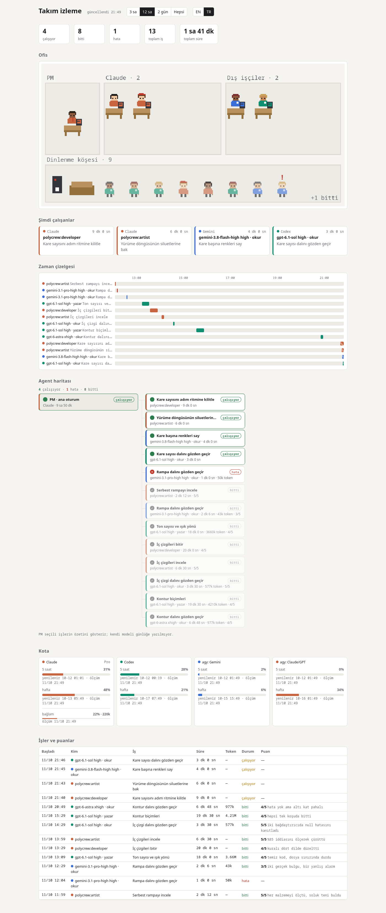

# polycrew

**Claude Code için çok modelli kadro.** Uzun projeler oturumdan oturuma hafızasını korur. Büyük işler küçük bir takıma bölünür: Claude rolleri ve dış işçi olarak Codex ve Gemini, ölçülmüş kalite ve maliyete göre seçilir. Hepsini tek bir canlı sayfadan izlersin.

[English](README.md)



## Ne işe yarar

Claude Code tek bir oturumda güçlü. Uzun projelerde ise üç sorun çıkar:

1. **Oturumdan oturuma unutur.** Kararlar, açık işler ve "nerede kaldık" sohbet geçmişinde kalır; ertesi gün yoktur.
2. **Agent'lar pahalı ve görünmez.** Paralel birkaç alt agent kullanım limitini birkaç saatte bitirir. VS Code eklentisinde katlanmış satırlar olarak durdukları için kimin ne yaptığı görünmez.
3. **Her işte en iyi tek bir model yok.** Codex dikkatli ve ucuz bir gözden geçirici. Görsel işi Claude daha iyi yargılıyor. Gemini'nin kotası bol. Hangisinin nerede kullanılacağını söyleyen bir şey yok.

polycrew her birine bir cevap veriyor:

- **Oturum düzeni.** Her projede `CLAUDE.md` (kurallar), `PLAN.md` (checkbox'lı aşamalar), `docs/decisions/` altında numaralı karar notları ve hazır başlangıç promptlu `NEXT_SESSION.md` bulunur. Oturumu açmak ve kapatmak iki komuttur.
- **PM'in yönettiği takım.** Ana oturum proje yöneticisidir. Aşamayı akışlara böler, maddeleri rollere verir: geliştirici, sanatçı, gözden geçirici, tasarımcı, araştırmacı, lider. Geliştiriciler kendi git worktree'sinde ve dalında çalışır; `main`'e yalnız PM birleştirir.
- **Dış işçiler.** Codex ve Gemini (`agy` üzerinden), seçilen model ve eforla, okur ya da yazar kipte, etkileşimsiz ve tam kayıtla çalışır. Böylece iş üç ayrı kotaya dağılır.
- **Ölçülmüş ve öğrenen kadro.** Hangi işin (rolüne, alanına ve zorluğuna göre) hangi işçiye gideceği tahminden değil, gerçek koşulardan gelir: puan, süre, token ve kota payı. PM'in verdiği her puan bir deftere yazılır, `roster.py suggest` işçileri oradan sıralar. Bkz. [`skills/team/roster.md`](skills/team/roster.md), karar [`0002`](docs/decisions/0002-agent-deneyi.md) ve [`0004`](docs/decisions/0004-dinamik-kadro.md).
- **Canlı görünürlük.** Kancalar ve işçi betiği tek bir olay günlüğüne yazar. Yerel bir sayfada şunlar görünür: agent haritası (kimi kim başlattı, kim hâlâ çalışıyor), zaman çizelgesi, üç sağlayıcının kota kartları, her işçinin son raporu ve PM'in puanları. Oturum sonunda aynı görünüm paylaşılabilir bir rapora dönüşür.

## Komutlar

`/polycrew:<ad>` ya da, ad tek olduğunda, yalnız `/<ad>` ile çağrılır.

0.5.0'da adlar İngilizceye çevrildi:

| Eski | Yeni |
|---|---|
| `/oturum-ac`, `/oturum-kapat` | `/session-start`, `/session-end` |
| `/proje-kur`, `/karar` | `/project-setup`, `/decision` |
| `/takim`, `/dis-ajan`, `/izle` | `/team`, `/external-agent`, `/watch` |
| `lider`, `gelistirici`, `gozden-gecirici` | `lead`, `developer`, `reviewer` |
| `sanatci`, `tasarimci`, `arastirmaci` | `artist`, `designer`, `researcher` |
| `dis-ajan.sh okur\|yazar`, `kota` | `external-agent.sh read\|write`, `quota` |
| `kadro.py oneri`, `ozet` | `roster.py suggest`, `summary` |
| zorluk K / O / Z | E / M / H |

Eski projeler bozulmaz: `SONRAKI_OTURUM.md` not dosyası olarak tanınır, puan defterindeki eski adlar okurken çevrilir. Ayrıntı: [`0007`](docs/decisions/0007-ingilizce-yuzey.md).

| Komut | Ne yapar |
|---|---|
| `/project-setup` | Projeye `CLAUDE.md`, `PLAN.md`, `NEXT_SESSION.md` ve `docs/decisions/` kurar; var olanın üstüne yazmaz. |
| `/session-start` | Notları okur; git'i, worktree'leri ve testleri denetler; geri bildirimi sorar; plan moduyla başlar. |
| `/session-end` | Checkbox'ları işaretler, kararları yazar, notları ve başlangıç promptunu günceller, takım raporunu yayımlar, commit atar. |
| `/decision` | Numaralı kısa bir karar notu yazar. |
| `/team` | Bir aşamayı takımla yapar: PM böler, işi zorluğa göre dağıtır, gözden geçirtir, birleştirir. |
| `/external-agent` | Bir görevi Codex'e ya da Gemini/agy'ye yaptırır (model, efor, okur ya da yazar) ve her şeyi kaydeder. |
| `/watch` | Canlı takım sayfasını açar, oturum raporunu üretir. |

### Roller (`agents/`)

| Rol | Varsayılan model | Kod yazar mı? | İşi |
|---|---|---|---|
| `developer` | Sonnet, yüksek efor | evet, kendi worktree'sinde | Bir maddeyi testleriyle kodlar, kendi dalında commit atar. |
| `reviewer` | Sonnet, yüksek efor | hayır | Bir dalı projenin bitti tanımına göre denetler. |
| `artist` | Opus | hayır | Görsel çıktıyı yargılar ve ölçer (renk, kontrast, tek kalan piksel). |
| `designer` | Opus | hayır | Seçeneklerden adım adım plan ve karar taslağı çıkarır. |
| `researcher` | Haiku | hayır | Kodda ve webde araştırır, kaynaklarıyla cevaplar. |
| `lead` | Sonnet | hayır | Gerçekten büyük ve paralel bir aşamada bir akışı yürütür. |

## Gereksinimler

- [Claude Code](https://docs.claude.com/en/docs/claude-code) (CLI, VS Code eklentisi ya da masaüstü uygulaması).
- `bash`, `git` ve Python 3 (yalnız standart kütüphane).
- Dış işçiler için (isteğe bağlı):
  - [Codex CLI](https://github.com/openai/codex), giriş yapılmış;
  - Gemini için `agy` (Antigravity CLI).
  - Oturum düzeni ve Claude takımı bunlar olmadan da çalışır.

## Kurulum

GitHub'dan:

```bash
claude plugin marketplace add MZDemirel/polycrew
claude plugin install polycrew@polycrew
```

Yerel kopyadan (geliştirme için):

```bash
git clone https://github.com/MZDemirel/polycrew.git
claude plugin marketplace add ./polycrew
claude plugin install polycrew@polycrew
```

Ardından açık oturumda `/reload-plugins` çalıştır ya da yeni bir oturum aç.

- **Güncelleme:** `claude plugin marketplace update polycrew && claude plugin update polycrew@polycrew`
- **Kaldırma:** `claude plugin uninstall polycrew@polycrew`

## Tipik bir oturum

```text
/project-setup     # proje başına bir kez: kurallar, plan, kararlar, devir notu
/session-start     # her oturum: notları oku, git ve testleri denetle, planla
/team         # takıma değecek bir aşamada; /watch canlı sayfayı açar
/session-end   # notlar, kararlar, takım raporu, commit
```

`/session-end`, `NEXT_SESSION.md`'ye bir başlangıç promptu yazar. Bir dahaki sefere onu yapıştırırsın; yeni oturum kalınan yerden başlar.

## Takımı izlemek

```text
/watch
```

Sayfa `http://localhost:8770` adresinde açılır. VS Code'da `Ctrl+Shift+P → Simple Browser: Show` ile açılır. İngilizce ve Türkçedir: tarayıcının diline göre açılır, EN/TR düğmeleri ya da `?lang=tr` ile değişir. Birkaç saniyede bir yenilenir ve şunları gösterir:

- **Şimdi çalışanlar:** rol ya da model, iş, geçen süre.
- **Agent haritası:** soldan sağa bir ağaç; kökte PM, dallarında başlattığı işçiler (Claude rolleri, Codex, Gemini). Çalışan işçi yeşildir ve nabız gibi atar, biten solar, üstte sayım durur. "Kim ne yapıyor, kimi kim başlattı" sorusunu tek bakışta yanıtlar.
- **Zaman çizelgesi:** Claude turuncu, Codex yeşil, Gemini mavi. Bir şeride tıklayınca işçinin son raporu ve görevi açılır.
- **Kota:** sağlayıcı başına bir kart, son ölçümüyle: Codex'in 5 saatlik ve haftalık penceresi, Gemini, agy üzerinden Claude ve Claude Code'un kendisi. Pencerenin yenilenme saatinden eski ölçüm soluk ve "eski ölçüm" etiketiyle görünür.
  - Claude'un kendi kullanımı CLI'dan okunmuyor. PM onu okur (masaüstü uygulamasının kullanım aracı ya da `/usage`) ve `skills/watch/claude-quota.py --five-hour <%> --week <%> ...` ile yazar; betik argümansız son ölçümü yazdırır, 5 saatlik pencerenin %80'inde ya da haftanın %70'inde uyarır. Kendiliğinden güncellenmez.
- **İşler ve puanlar:** süre, token, durum ve PM'in gerekçeli 1–5 puanı.

Arka planda:

- Kancalar (Agent aracında `PreToolUse`, `SubagentStart`, `SubagentStop`) ve `external-agent.sh` tek bir günlüğe yazar.
- PM puanı `python3 hooks/events.py score <iş id> <1-5> "<gerekçe>" --worker <işçi> --role <rol> --field <alan> --difficulty <E|M|H>` ile ekler. Puan sayfada görünür ve deftere eklenir.
- `skills/watch/watch.py report --lang tr --out rapor.html` aynı görünümü durağan bir sayfa olarak üretir; `/session-end` onu yayımlar.
- Resimler örnek bir günlükten: `docs/img/ornek_gunluk.py en|tr <dosya>`.

## Kadro (`roster.py`)

Puanlar zamanla solar: 30 günlük bir puan yarım sayar (`--half-life`), eski bir izlenim sonsuza kadar kalmaz, nötre döner. Claude işçileri model sürümüyle kaydedilir (`claude/developer/sonnet-5-5`); yeni model kendi koşularıyla sıralanır. Oturum özeti, az verisi olan bir işçiyi kolay bir işte **denemek** için de önerir.

```bash
python3 skills/team/roster.py suggest                 # rol ve alan başına en iyi işçi
python3 skills/team/roster.py suggest --role developer --field py # daraltılmış
```

- Defter `~/.local/share/polycrew/puanlar.jsonl`. Oturumlar ve projeler arasında kalır; ölçülen koşulardan alınmış tohum veriyle başlar.
- Tablo rol ve alan başına en iyi işçiyi düzeltilmiş puanla (az örnek puanı ortaya çeker), örnek sayısıyla, ortalama süreyle ve son notun tarihiyle gösterir. Verisi az satırlar işaretlidir.
- İş dağıtmadan önce bak ve puanlamayı sürdür: bozulmaya başlayan (ya da izinleri görevde tek tek sayılınca çalışmaya başlayan Gemini gibi düzelen) işçi tabloda yer değiştirir.
- Kullanımdan bir ders: aynı anda birkaç Claude agent'ı 5 saatlik pencereyi hızla bitirir. Claude agent'larını teker teker çalıştır, ağır kodu önce Codex'e ver.

## Dış işçiler (isteğe bağlı)

```bash
skills/external-agent/external-agent.sh codex gpt-6.1-sol high read  <klasör> gorev.md     # yalnız okur: gözden geçirme
skills/external-agent/external-agent.sh codex gpt-6.1-sol high write <worktree> gorev.md   # yazar, yalnız worktree'de
skills/external-agent/external-agent.sh quota                               # Codex ve agy'nin güncel kotası
```

- **Yazar kip** ana çalışma ağacını reddeder; önce bir worktree aç.
- **İşçiler push etmez** ve git kancasını atlatmaz.
- **Sabit git kuralları** tek dosyada durur, [`rules/git.md`](rules/git.md): commit'te araç imzası (`Co-Authored-By`) yok, PR açıklamasında araç satırı yok, birleşen dal silinmez, işçiler push etmez. Projeye göre sorulmaz; `/project-setup` her projenin `CLAUDE.md`'sine yazar, betik dış işçilere iletir.
- **Kayıt:** her koşu görevi, ham çıktıyı, son mesajı, süreyi, token'ı ve çıkış kodunu `~/.cache/polycrew/dis-ajan/` altına yazar.
- **Süre sınırı:** bir koşu bir saat sonra durdurulur (`EXTERNAL_AGENT_TIMEOUT`, saniye). Durdurulan koşu son mesaj bırakmaz; yazar işçiden ara commit iste, ağır işte sınırı yükselt.
- **Paralel koşu:** bash betiği satır satır okur; uzun paralel koşularda betiğin bir kopyasını kullan. Kopya olay günlüğünü bulamazsa `POLYCREW_EVENTS_SCRIPT=<eklenti>/hooks/events.py` ver; yoksa işçi sayfada görünmez.
- **Kum havuzu:** Codex kum havuzunda ağa çıkamaz, soket açamaz, Blender gibi araçları başlatamaz. Worktree'yi (bağımlılıklar, git dışı varlıklar) sen hazırla, paket önbelleğini `EXTERNAL_AGENT_EXTRA_DIRS` ile ver, o denetimleri PM olarak sen koş.
- **agy izinleri:** etkileşimsiz kipte `agy`, izin listesinde (`~/.gemini/antigravity-cli/settings.json`) olmayan ilk komutta bütün işi düşürür. Kuralları dar tut; genişletmeyi bilerek yap.
- **Model seçimi:** bkz. [`roster.md`](skills/team/roster.md). Ölçülen koşularda:
  - en iyi gözden geçirici Codex `gpt-6.1-sol` çıktı: her bulgu kanıtlı, yanlış alarm yok, inceleme başına 5 saatlik pencerenin yaklaşık %3'ü;
  - Claude PM, sanatçı ve zor kod için ayrıldı.

## Veri ve gizlilik

- Her şey senin makinende kalır:
  - olay günlüğü: `~/.cache/polycrew/olaylar.jsonl`;
  - işçi kayıtları: `~/.cache/polycrew/dis-ajan/`;
  - puan defteri: `~/.local/share/polycrew/puanlar.jsonl`.
- Senin çalıştırdığın CLI'lar dışında hiçbir yere bir şey gönderilmez.
- Oturum raporu işçi raporlarını ve görevleri içinde taşır; yayımlamadan önce gizli bilgi olmadığına bak.

## Dil

- Komutlar, roller, skill metinleri ve betik seçenekleri İngilizcedir; eklentinin projene yazdığı dosyalar `/project-setup`'ta seçtiğin dilde olur. Bu deponun kendi notları, karar kayıtları ve olay günlüğünün iç alan adları Türkçedir. 0.5.0 öncesinde kurulan projeler çalışmaya devam eder: `SONRAKI_OTURUM.md` not dosyası olarak tanınır, puan defterindeki eski rol adları okurken çevrilir.
- Claude bunları her dilde uygular. Seninle hangi dilde konuşacağını projenin `CLAUDE.md`'si belirler.

## Depo düzeni

```text
.claude-plugin/   eklenti ve marketplace tanımları
agents/           roller (model, efor, araçlar)
skills/           session-start, session-end, decision, project-setup, team (+ roster.md, roster.py), external-agent (+ external-agent.sh), watch (+ watch.py, claude-quota.py, page.html)
rules/            sabit git kuralları (tek kaynak; skill'ler ve roller buraya işaret eder)
hooks/            SessionStart "nerede kaldık", events.py (olay günlüğü ve puan defteri)
docs/decisions/   neden böyle olduğu
deney/            ölçülen koşular: görevler, cevap anahtarları, puanlar
tests/            olay günlüğü, canlı sayfa ve git kuralları için birim testleri
```

## Geliştirme

```bash
claude plugin validate .
bash -n hooks/session_start.sh skills/external-agent/external-agent.sh
python3 -m unittest discover tests
python3 skills/watch/watch.py --port 8771      # sayfayı dene; deneme günlüğü için POLYCREW_EVENTS=<dosya>
```

Eklenti kendi düzeniyle geliştirilir: [`PLAN.md`](PLAN.md), [`SONRAKI_OTURUM.md`](SONRAKI_OTURUM.md) (not dosyasının 0.5.0 öncesi adı) ve [`docs/decisions/`](docs/decisions/).

## Lisans

[MIT](LICENSE)
