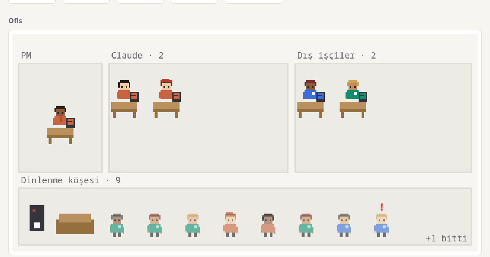

# 0012: İzleme sayfasında ofis görünümü

- **Tarih:** 2026-10-11
- **Durum:** Kabul edildi; `0003` ve `0005`'in görünürlük kararlarına ekler.

## Bağlam

Kullanıcı, ofis ortamını canlandıran eklentilere benzer bir görünüm istedi. Sayfa zaten kimin çalıştığını, rolünü, sağlayıcısını ve durumunu 3 saniyede bir alıyor; eksik olan bunu bir bakışta, sevimli bir resim olarak göstermekti.

## Kararlar

1. Ofis sayfanın en üstünde kendi bölümüdür; kartlar, zaman çizelgesi, harita ve tablo aynı kalır. Canvas ekran okuyucuya kapalı olduğu için erişilebilir karşılığı onlar; canvas'ın `aria-label`'ı özet taşır.
2. Tek HTML, dış kütüphane ve derleme adımı yok. Mantıksal 320×150 piksellik ızgara tam sayı katıyla büyütülür (`image-rendering: pixelated`).
3. Yerleşim: solda PM, ortada Claude odası, sağda dış işçiler odası (Codex ve agy; agy üzerinden Claude da burada), altta dinlenme köşesi. Çalışan masada yazar; biten son 8 iş dinlenme köşesinde soluk durur, fazlası "+N". Hata "!", bilinmiyor "?". Oda başına 8 masa, fazlası "+N".
4. Karakterler kodla çizilir (12×16): gömlek sağlayıcı rengi (CSS değişkenlerinden, iki temada doğru), rol başına küçük bir aksesuar, saç ve ten iş kimliğinden türeyen sabit tohumla. Çizim tek fonksiyondan geçer (`karakterCiz`); `OFIS_SPRITE` bir sprite sayfası adresi taşırsa figür oradan kesilir.
5. Saf mantık (`ofisYerlesim`, `ofisTohum`) `OFIS-MANTIK` işaretleri arasında durur ve DOM'a dokunmaz; test onu sayfadan çıkarıp Node ile koşar.
6. Üstüne gelince balon (üstte yer yoksa altta), tıklayınca mevcut yan panel. Animasyon saniyede yaklaşık 4 kare; `prefers-reduced-motion`'da ve sekme gizliyken durur.

## Denemeler

- Sentetik günlükle (4 çalışan, 10 biten, 1 hata) yerel sunucuda, uygulamanın tarayıcısında: koyu ve açık tema, İngilizce ve Türkçe, 375 piksel genişlik (yatay kaydırma yok), balon, tıklamayla panel; konsolda hata yok.
- Tarayıcıda görülüp düzeltilenler: koyu temada monitör ve kahve makinesi bembeyaz çıkıyordu (mürekkep rengi kullanılmıştı, sabit koyu gövde rengine alındı); dinlenme köşesinin etiketi üst odalara değiyordu; üst sıradaki figürün balonu kutunun dışına taşıyordu.
- 76 test yeşil (72 + 4; Node yoksa üçü atlanır): odalara dağılım ve sıra, sığmayanların sayıyla gösterilmesi, herkesin odasının içinde ve ayrı masada olması, aynı kimliğin aynı görünümü, raporun ofisi taşıması.

## Açık kalan

- Gerçek bir takım oturumunda görülmedi. README'nin üst görseli ve tam sayfa görüntüsü örnek günlükle (`docs/img/ornek_gunluk.py`) alındı: canlı sayfa veriyi eşzamansız yüklediği için başsız Firefox boş sayfa çekti; görüntü, verinin sayfaya gömüldüğü geçici bir kopyadan alındı (canlı sayfayla aynı görünüm).
- Rapor kipinde (gömülü veri) yalnız testle doğrulandı, tarayıcıda bakılmadı: uygulamanın tarayıcısı yerel dosyayı durağan gösteriyor.
- Karakterler odalar arası yürümüyor; konum anında değişiyor. Pixlender sprite'ları gelmedi.
- 375 pikselde ofis küçük ama okunuyor; daha dar ekranda etiketler sıkışabilir.
