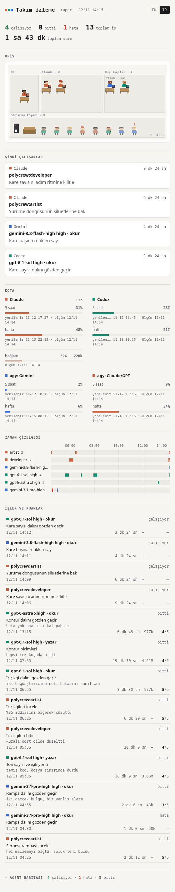

# 0015: İzleme sayfasının yeniden tasarımı

- **Tarih:** 2026-11-12
- **Durum:** Kabul edildi; `0003`'ün sayfasını yeniden düzenler, `0012`'nin ofisine etiket ekler, `0014`'ün çizelge notunu kapatır.

## Bağlam

Kullanıcı: "izleme sayfası genelde yarım sayfa oluyor, yanda oturum sohbeti var; yarım ekran olunca kaymalar oluyor, özellikle çalışma saatini gösteren kısımda. Ayrıca arayüz çok AI slop duruyor."

Eski sayfa gerçek olay günlüğüyle 560 ve 700 px genişlikte ölçüldü:

| Sorun | Ölçüm |
|---|---|
| Eksenin ilk etiketi sol kenarda kesiliyor | 560 px'te `04/10 03:00` yerine `/10 03:00` |
| Tarihli etiketler yapışıyor | 700 px'te 6 aralığın 6'sı 4 px'ten dar |
| Etiket sütunu sabit 16rem | 700 px'te 655 px'lik kutunun 378 px'i çubuğa kalıyor |
| İş başına bir satır | "Hepsi"de 175 iş → çizelge 4240 px |
| Harita ve tablo yana taşıyor | 700 px'te harita 969/668, tablo 840/666 |

Ortak neden: kırılma noktaları (640, 700 px) pencereye bakıyordu ve yarım panel tam o eşiklere düşüyordu. Görünümde de hiyerarşi yoktu: her şey aynı kenarlıklı kutu, beş eşit sayaç, altı eşit bölüm, aynı iş dört yerde.

## Kararlar

1. **Çizelge işçi başına şerit.** Satır bir işçidir: Claude agent'ında rol, dış işçide model ve efor. İşler o şeritte çubuktur; zamanı çakışan işler şeridin alt satırına iner. Çalışanı olan şerit üstte, sonra son etkinliğe göre. Model ayrımı şeritte yok (günlükte aynı model üç ayrı adla geçiyor: `sonnet`, `claude-sonnet-5-5`, boş); iş listesinde ve çubuğun üstüne gelince görünür.
2. **Eksen ölçülen genişliğe göre.** Adım, etiketleri sığan en küçük adımdır (etiket başına 38 px, gün ve saat birlikteyse 76 px, artı 12 px boşluk; en çok 8 etiket). Kenardan taşacak etiket kenara yaslanır, komşusuna değecek etiket atılır. Günlük adımda etiket yalnız gündür ve yerel gece yarısına düşer (`0014`'te UTC gece yarısı yerelde `03:00` görünüyordu). Panel sürüklenince `ResizeObserver` yeniden çizer.
3. **Eksen işlerin aralığına oturur.** Kimse çalışmıyorsa son işin bitişinde biter; "şimdi"ye kadar boş uzamaz (`0014`'ün açık notu).
4. **Beş sayaç kutusu yerine tek durum satırı.** Çalışan ve hata sayıları sıfır değilse renkli; "bilinmiyor" yalnız varsa görünür.
5. **"Şimdi çalışanlar" yalnız çalışan varken çizilir.**
6. **İş tablosu yerine tek liste.** Genişte tek satır, 760 px altında üç kısa satır; yana kaymaz. En yeni 40 iş, altında "Tümünü göster (N)".
7. **Agent haritası her genişlikte girintili ağaç** (sabit 360 px düğümler kalktı) ve katlanır. Yalnız ağacın derinliği varsa (lider ya da agent başlatan agent) kendiliğinden açık gelir; kullanıcının seçimi yenilemede korunur.
8. **Kırılmalar kapsayıcıya bağlı** (`container-type: inline-size`, `@container`): 760 px (liste), 400 px (şerit etiketi çubuğun üstüne).
9. **Görsel dil.** Kimlik piksel ofisten: bölüm başlıkları küçük, büyük harf, mono; sayılar mono ve `tabular-nums`. Bölümler kutuyla değil üst çizgi ve boşlukla ayrılır; kenarlıklı yüzey yalnız ofiste, çalışan kartlarında ve yan panelde. Kartların sol renk şeridi kalktı. Başlıkta üç sağlayıcının renginde üç kare. Dış font ve kütüphane yok. Renk değişkenleri aynı (canvas onları okuyor).
10. **Ofiste etiket (`0012`'nin açığı).** Masadaki işçinin başının üstünde model kısaltması (`gpt-6.1-sol` → `sol`, `gemini-3.8-flash-high` → `flash`); aynı odada aynı etiket birden çoksa başlama sırasıyla numara (`sol1`, `sol2`). Okur gözlüklü, yazar kalemli.
11. Saf mantık `CIZELGE-MANTIK` işaretleri arasında (`cizelgeSeritler`, `cizelgeEksen`), `OFIS-MANTIK` gibi Node ile test edilir. `watch.py`, `api/durum` ve gömülü raporun veri şeması değişmedi.

### Denenip bırakılanlar

- Şerit adı olarak tam `kim()` (rol + model, model + efor + okur/yazar): "Hepsi"de 28 şerit, 560 px'te 1386 px. Rol ya da model + efor ile 14 şerit, 398 px.
- Şerit etiketini 560 px altında çubuğun üstüne almak: her şerit iki satır oluyordu. Eşik 400 px'e indi; yarım panelde etiket yanda kalır.
- Ofis etiketini masanın altına yazmak: ikinci sıranın etiketi odanın dışına, dinlenme köşesinin başlığına taşıyordu. Başın üstüne alındı.

## Ölçümler

Aynı gerçek günlük, "Hepsi" penceresi (177 iş), uygulamanın tarayıcı panelinde:

| Genişlik | Yatay taşma | Eksen etiketi | Üst üste | Kutunun dışında | Şerit | Çizelge yüksekliği |
|---|---|---|---|---|---|---|
| 400 px | yok | 7 | 0 | 0 | 14 | 728 px |
| 560 px | yok | 6 | 0 | 0 | 14 | 398 px (önce 4240) |
| 700 px | yok | 7 | 0 | 0 | 14 | 398 px |
| 1100 px | yok | 7 | 0 | 0 | 14 | 398 px |

- 12 saatlik pencerede 560 ve 700 px: 2 şerit, 66 px, etiketler `14:05 14:10`.
- Durağan rapor (`watch.py report`), 560 px, açık tema: taşma yok, 177 çubuğun hiçbiri şeridin dışında değil.
- Tarayıcıda görülüp düzeltilenler: 5 haftalık eksende çalışan işin 3 px'lik çubuğu sağ kenarda kesiliyordu (`left: min(…, 100% - 3px)`); raporda pencere düğmeleri `hidden` olduğu hâlde görünüyordu (`.seg { display: inline-flex }` eziyordu; eski sayfada da vardı), `[hidden] { display: none !important }` eklendi.
- 91 test yeşil (85 + 6): şeritler ve alt satırlar, çalışanın önceliği, eksenin dar genişlikte seyrelmesi ve taşmaması (5 genişlik × 4 aralık), kenar hizası, etiket türü ve yerel gece yarısı, ofis etiketleri.
- README resimleri örnek günlükle yeniden alındı (`docs/img/ornek_gunluk.py`, `watch.py report`, başsız Chrome 1400 px).

## Açık kalan

- "Hepsi"de haftalara yayılan eksende çubuklar çizgi kalınlığında; oturumlara göre kümeleme ya da yakınlaştırma yok.
- PM düğümünün süresi işlerin toplamı (paralel işlerde duvar saatinden uzun); eski davranış, dokunulmadı.
- Çubuklar klavyeyle gezilmiyor; klavye yolu iş listesi ve harita.
- Gerçek bir takım oturumunda yarım panelde bu oturum boyunca açık kaldı (iki işçi çalışırken); başka bir projede denenmedi.
